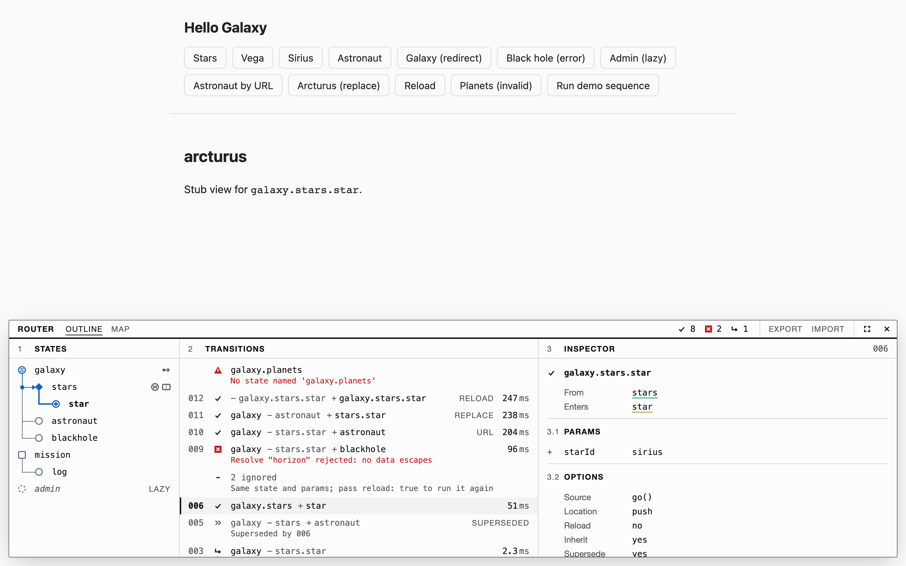
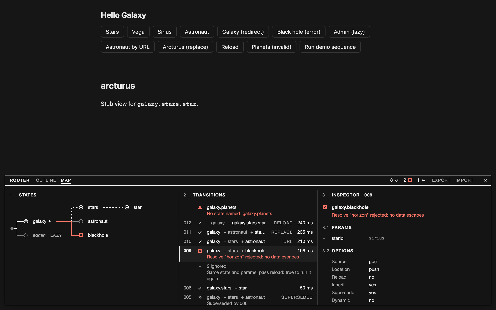
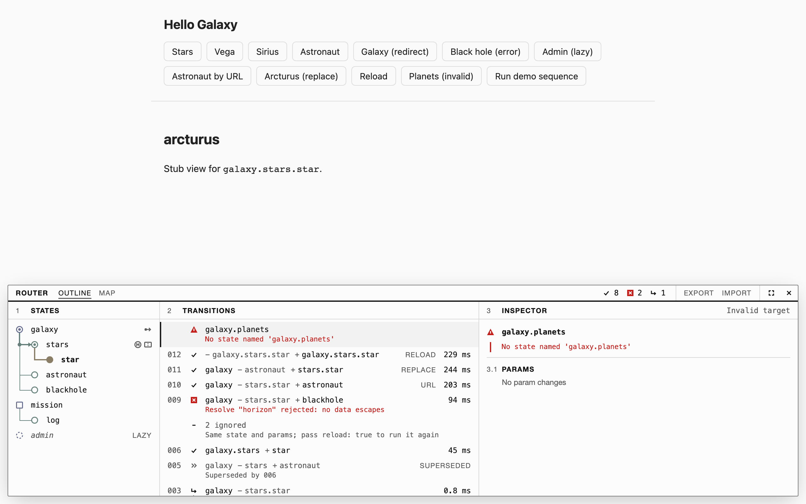
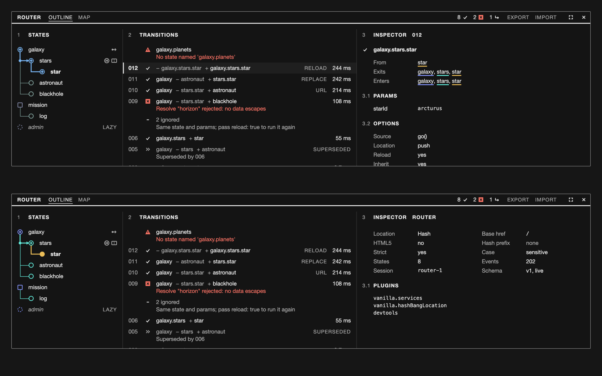
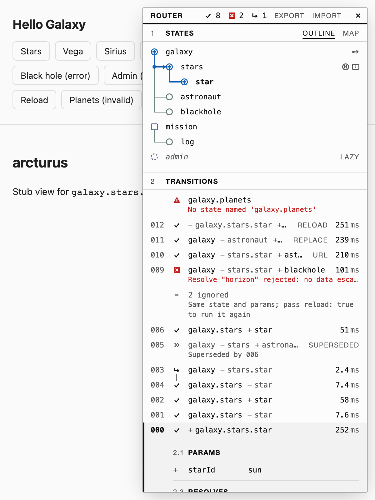
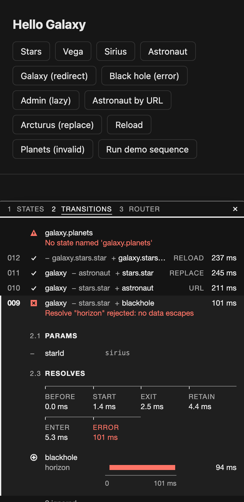
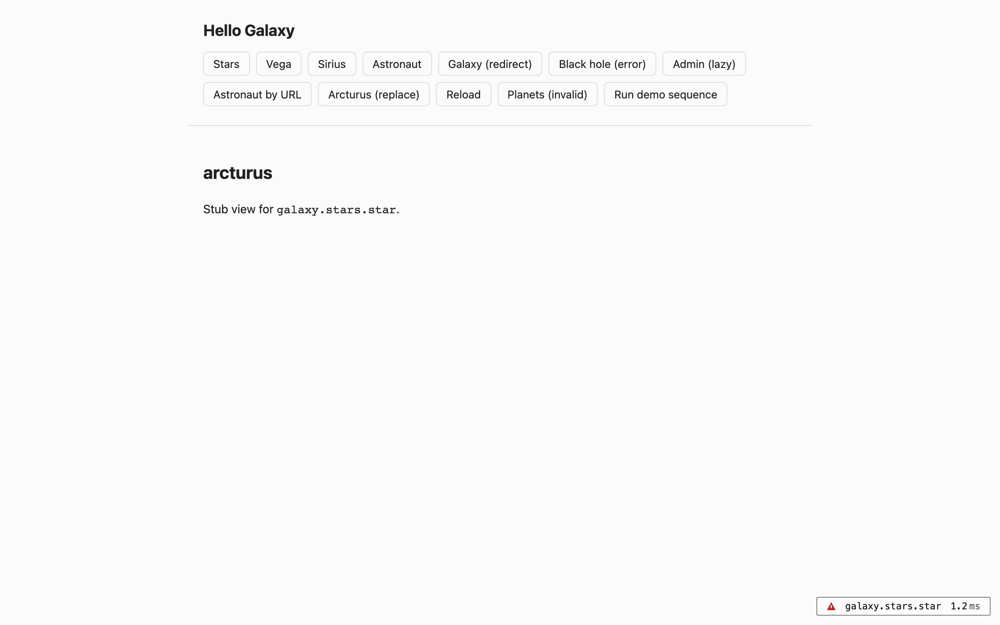

# Router visualizer proposal

A replacement for `@uirouter/visualizer`: a Lit custom element that shows the
state tree and the transition log of any `@uirouter/core` router. This is a
research proposal. Its implementation is
[`packages/ui-router-devtools`](../../packages/ui-router-devtools/README.md),
a private package that is not published.

[Devtools scope and ecosystem](devtools.md) covers what the package can provide
beyond the panel and which devtools hosts it can plug into.

## Summary

- Build `<ui-router-devtools>`: a Lit element that takes any `UIRouter`, with a
  thin `UIRouterPlugin` beside it so `router.plugin(...)` keeps working.
- It opens from a 28px pill. The primary view is an indented state outline
  (`role="tree"`) and a transition log; the node-link diagram is a Map tab in the
  wide dock, laid out by `d3-hierarchy`.
- Nodes are HTML elements over one SVG edge layer. No canvas, no graph library.
- The look is a specification sheet: one grotesque, two sizes, two weights, ink
  on paper, and one red that means fault.
- The element measures 59.5 kB min / 18.3 kB gzip with `lit`
  external, against 85.0 kB / 25.6 kB for `@uirouter/visualizer` 7.2.1, and passes
  axe with no violations. The adapter and recorder alone are 7.2 kB / 3.1 kB.

| Wide dock, outline                                                | Wide dock, map, fault selected                                |
| ----------------------------------------------------------------- | ------------------------------------------------------------- |
|  |  |

| Reasons, including an invalid target               | Transition options and the router card                             |
| -------------------------------------------------- | ------------------------------------------------------------------ |
|  |  |

| Side sheet at 600px                                      | Bottom sheet at 390px                                                  | Pill                                         |
| -------------------------------------------------------- | ---------------------------------------------------------------------- | -------------------------------------------- |
|  |  |  |

All screenshots, light and dark, plus one under forced colours, are in
[`screenshots/`](screenshots/).

## What the current plugin costs

`@uirouter/visualizer` 7.2.1 was published on 2020-09-19; the June 2022 date on
npm is a metadata change. Upstream moved the package into its monorepo unchanged,
and the 2026 work there is build modernisation, not features. It still has about
32,000 weekly downloads.

Five examples load it, and each one carries:

- a patch that makes the transition-history scroller focusable and labelled, to
  clear two axe rules (#1902);
- a `d3-color` override for an advisory reached through `d3-interpolate =1.4.0`;
- CSS that hides both overlays below 600px or 640px;
- a text-colour fix, because the panels set a light background and no text colour.

It also installs a body-wide `mousemove` listener, opens details only on hover,
has no `aria` or `role` attributes of its own, injects its CSS at runtime, and
reads core internals (`$$state()`, `PathNode.resolvables`,
`globals.successfulTransitions`). `examples/hellosolarsystem-mobx/index.html`
still carries the hiding CSS although it no longer loads the plugin.

What upstream users asked for, from the visualizer's issue tracker:

| Ask                                                                  | Upstream issues           |
| -------------------------------------------------------------------- | ------------------------- |
| Large trees: collapse, no overlap, search                            | 9, 20, 25, 42             |
| Placement that stays out of the app's way: dock, minimise, window    | 6, 10, 14, 18, 21, 24, 34 |
| More transition detail: data, resolve timing, redirects, lazy states | 7, 16, 19, 22, 23, 31     |
| CSP-safe styling                                                     | 12, 15                    |
| Hooks for sticky and deep-state-redirect labels                      | 281                       |

Accessibility and dark mode were never asked for upstream. Our examples patch
both.

## Options compared

### Layout and rendering

Sizes are min / gzip in kB, measured with esbuild for the import path a tree
layout needs. Layout time is for a random 1,000-node tree in Node.

| Option                             | Size          | Layout time  | Rendering       | Tree quality        | Verdict                                                                   |
| ---------------------------------- | ------------- | ------------ | --------------- | ------------------- | ------------------------------------------------------------------------- |
| `d3-hierarchy` (`tree`, `cluster`) | 8.2 / 3.3     | 0.29 ms      | none; we draw   | tidy tree           | **Recommended.** The incumbent's own algorithm, so its layouts carry over |
| Hand-written tidy tree             | about 3 / 1.3 | similar      | none; we draw   | tidy tree           | Runner-up, if zero dependencies matters                                   |
| `d3-flextree`                      | 7.9 / 3.2     | not measured | none; we draw   | variable node sizes | Dormant since 2021; pins `d3-hierarchy` 1                                 |
| `@dagrejs/dagre`                   | 48.6 / 17.0   | 137 ms       | none; we draw   | layered DAG         | A DAG layout for a tree                                                   |
| cytoscape.js                       | 451 / 143.5   | 46 ms        | canvas          | `breadthfirst`      | Nodes can't take focus or ARIA; colours can't read `var()` or `oklch`     |
| elkjs                              | 1494 / 450    | 122 ms       | none; we draw   | strong for DAGs     | Too large; EPL-2.0 or GPL-3.0                                             |
| `@xyflow/system`                   | 64–80 / 22–28 | no layout    | DOM             | none                | Internal package, not meant for outside use                               |
| G6, X6, vis-network, sigma         | 113–422 gzip  | not measured | canvas or WebGL | varies              | Built for graphs far larger than this                                     |
| Graphviz wasm                      | 488–637 gzip  | not measured | static SVG      | good                | No live updates                                                           |
| `d3-force`                         | small         | iterative    | none; we draw   | none                | Positions move whenever a lazy state loads                                |

A router's states are a strict tree of 5 to 50 nodes, sometimes a few hundred.
Transitions are overlays on that tree, not extra edges, so the problem never
needs a DAG engine.

cytoscape is the right tool for the atlas sheets on `www/atlas`, where the graph
is a one-off figure and the data model is the thing being edited. Here the data
model is the state registry, so layout is computed either way; what the shipped
tool needs is focusable nodes, CSS-token theming and a small bundle, and
cytoscape gives up all three.

### Surface

| Option                                      | For                                                           | Against                                                             |
| ------------------------------------------- | ------------------------------------------------------------- | ------------------------------------------------------------------- |
| Custom element the app places               | Standard; composes with any framework; app controls placement | One more line than `router.plugin()`                                |
| Plugin that mounts its own DOM (today)      | One line                                                      | Owns `body`; no say over placement; not usable as an embedded panel |
| **Element plus a thin plugin**              | Both of the above; the plugin is about 15 lines               | Two entry points to document                                        |
| Panel in the parent page over `postMessage` | Leaves the docs iframe entirely                               | Needs a transport and a handshake; a later stage                    |
| Browser devtools extension                  | No in-page footprint                                          | Store review, per-browser builds, nothing visible in docs embeds    |

### Docking

| Mechanism                                | Baseline status, November 2026    | Use                                                    |
| ---------------------------------------- | --------------------------------- | ------------------------------------------------------ |
| Popover API (`popover="manual"`)         | Newly available                   | The panel, in the top layer                            |
| `<dialog>`                               | Widely available                  | Large values                                           |
| Size container queries                   | Widely available                  | Bottom sheet, side sheet or dock by container width    |
| `light-dark()`, `color-scheme`           | Newly available, widely available | All colour tokens                                      |
| `@starting-style`, `transition-behavior` | Newly available                   | Panel and row entry                                    |
| CSS anchor positioning                   | Core properties newly available   | Detail cards, with an inline fallback                  |
| Same-document view transitions           | Newly available                   | Not used; nothing in this design travels               |
| Document Picture-in-Picture              | Limited; top-level windows only   | A later pop-out; it cannot work inside the docs iframe |

The top layer is per document, so a popover inside an iframe stays inside the
iframe. The pill is therefore the default state, and `open` is not restored from
storage inside a frame.

## Recommended stack

- **Lit element**, styles in the shadow root through adopted stylesheets, which
  also answers the CSP ask.
- **`d3-hierarchy`** for the Map tab only; the outline needs no layout. The Map
  is part of stage 1.
- **HTML nodes over one SVG edge layer.** Nodes take focus, carry ARIA and theme
  from custom properties.
- **An adapter module** that turns a router into JSON-safe events on an
  `EventTarget`. The element reads only those events. This is the seam a
  `postMessage` transport plugs into later.
- **Peers:** `@uirouter/core` only. `lit` is a dependency. The element does not
  import `lit-ui-router` or the signals, effect or mobx companions, so it works
  with the Angular and React adapters too.
- **A companion package**, not part of `lit-ui-router`.

## API sketch

```ts nocheck
// 1. As a plugin: the element is appended to document.body.
import { DevtoolsPlugin } from 'ui-router-devtools/plugin';
router.plugin(DevtoolsPlugin);

// 2. As an element the app places.
import 'ui-router-devtools/define';
html`<ui-router-devtools .router=${router}></ui-router-devtools>`;

// 3. Opt-in loading, so examples pay nothing by default.
if (new URLSearchParams(location.search).has('visualizer')) {
  const { DevtoolsPlugin } = await import('ui-router-devtools/plugin');
  router.plugin(DevtoolsPlugin);
}
```

| Surface           | Members                                                                                                                                                       |
| ----------------- | ------------------------------------------------------------------------------------------------------------------------------------------------------------- |
| Properties        | `router`, `open`, `dock` (`auto`, `side`, `bottom`, `inline`), `history` (row limit), `storageKey`                                                            |
| Events            | `devtools-toggle`; `devtools-select-state`, cancelable                                                                                                        |
| Custom properties | `--uird-surface`, `--uird-surface-raised`, `--uird-ink`, `--uird-muted`, `--uird-rule`, `--uird-rule-strong`, `--uird-red`, `--uird-font`, `--uird-font-mono` |
| Parts             | `pill`, `panel`, `tree`, `node`, `log`, `transition`, `inspector`                                                                                             |
| Entry points      | `.` (adapter, recorder, schema), `./define`, `./plugin`, `./performance`, `./console`, `./testing`                                                            |

The name `ui-router-devtools` follows the repo's convention: `ui-router-*` for
packages that work with any adapter, `lit-ui-router-*` for Lit-only ones. Lit is
how the element is built, not what it requires of the host: it renders in its own
shadow root and reads only `@uirouter/core`. The unscoped `ui-router-visualizer`
is taken on npm, and `ui-router-devtools` also leaves room for the transport and
the Performance-panel track. Inside a `lit-ui-router` app the element can
fall back to the router context when `router` is unset; that lookup belongs in a
`lit-ui-router` subpath so the base package keeps one peer.

The adapter's events, as the package defines them in
[`src/schema.ts`](../../packages/ui-router-devtools/src/schema.ts). Every event carries a
schema version. A `transition` also carries its options (source, location,
reload, inherit), and a `result` carries a plain-language reason:

| Event        | Payload                                                                         | Source in core                                                   |
| ------------ | ------------------------------------------------------------------------------- | ---------------------------------------------------------------- |
| `states`     | name, parent, url, params, resolve tokens, future, abstract                     | `stateRegistry.get()`, `onStatesChanged`                         |
| `transition` | id, from, to, params, entering, exiting, retained, `redirectedFrom`             | `onBefore`, `Transition.$id`, `treeChanges()`                    |
| `phase`      | id, phase, start or end, state                                                  | each hook type registered at a very high and a very low priority |
| `resolve`    | id, token, state, start, end, ok, cached                                        | see the gap below                                                |
| `result`     | id, outcome (success, error, redirected, superseded, aborted, ignored, invalid) | `Transition.promise`, `Rejection.type`                           |
| `config`     | location kind, base href, hash prefix, strict mode, plugin names                | `urlService.config`, `getPlugin()`                               |
| `current`    | name, params                                                                    | `globals.current`, `globals.params`                              |

### What the adapter established about the data

- **Phase timing works from public API.** Hooks registered at extreme priorities
  bracket core's own hooks. `onExit`, `onRetain` and `onEnter` sort by state depth
  before priority, so the brackets arrive per state. A phase cut short by a
  redirect or a supersede has no end mark; the element closes it at the result.
- **Resolve timing has no clean public source.** A `Resolvable`'s promise does
  not exist yet when an `onStart` hook runs, and `injector().getAsync()` starts
  the resolve early, which changes behaviour. With the opt-in `timeResolves`
  option, off by default, the adapter wraps `resolveFn` on each transition's own
  `Resolvable` copies. That gives exact times and leaves order alone, and it is
  still monkey-patching. The clean fix is a small core
  change: a start and end notification in `Resolvable.resolve()`, or a listener
  on the trace emitters, which today write only to the console.
- **Individual hook calls are not observable** without patching core, so the
  inspector shows phases, not a row per hook.

## MVP

Stage 1 is what replaces the plugin in the five examples.

| In                                                                                       | Out, and where it goes                                            |
| ---------------------------------------------------------------------------------------- | ----------------------------------------------------------------- |
| Pill, with the current state, the last outcome and its duration                          | Resolve bars: stage 2, after the core question is settled         |
| Panel as bottom sheet, side sheet or dock, chosen by container width                     | Search and filter chips: stage 2                                  |
| State outline: `role="tree"`, arrow keys, collapse, lazy states                          | `postMessage` transport and a parent-page panel: stage 3          |
| Map tab in the wide dock, laid out by `d3-hierarchy`                                     | Performance-panel track: stage 3                                  |
| Transition log: redirect chains, superseded and ignored rows de-emphasised               | Hooks and views in the inspector: needs data core does not expose |
| Expanded row: phase ruler and param diff                                                 | Document Picture-in-Picture pop-out: stage 4                      |
| Selecting a row shows its entered, exited and retained states on the outline and the map | Dragging and resizing                                             |
| Polite live region for settled outcomes; never takes focus                               |                                                                   |
| Light, dark and forced colours; reduced motion; RTL rails                                |                                                                   |
| The thin plugin; opt-in loading in the examples                                          |                                                                   |
| A reason on every row that did not succeed, invalid targets included                     |                                                                   |
| Transition options in the inspector; `URL`, `REPLACE` and `RELOAD` tags on rows          |                                                                   |
| Router config card; session export and import                                            |                                                                   |
| Console and Performance-panel reporters; a test recorder                                 |                                                                   |

Stage 1 removes the patch, the `d3-color` override, the hiding CSS and the
text-colour fix from the five examples, and closes #1902.

Later stages:

1. **Stage 2:** resolve timing, search for large trees.
2. **Stage 3:** a `postMessage` transport with a handshake and an origin check,
   so the docs page can render the panel outside the 800px iframe. In the same
   stage, an opt-in that writes transitions to a custom track in the Chrome
   Performance panel through `performance.measure` with `detail.devtools`
   (Chrome 128 and later).
3. **Stage 4:** publish the event schema once a second consumer exists, and offer
   the element to the wider UI-Router family.

## Design direction

A specification sheet for your router. The panel is a list-first instrument: an
outline with a drawn rail, a numbered log, and an inspector. It is not a canvas,
a card dashboard or a diagram editor, and nothing travels across it.

The discipline comes from the principles of the 1976 NASA Graphics Standards
Manual: one typeface used in few sizes and weights, a strict grid, a palette of
black, white, greys and one red, and uniform numbering. None of NASA's identity
is used.

- **Type.** `"Helvetica Neue", Helvetica, Arial, sans-serif`, no webfont. Two
  sizes: 12px on a 16px line, and 11px uppercase captions tracked 0.08em. Two
  weights: 400 and 700. Flush left; only numerals align right, in tabular figures.
  Monospace (`ui-monospace, SFMono-Regular, Menlo, Consolas, monospace`, 11px) is
  kept for literal values in the inspector: param values and URL patterns.
- **Grid.** A 4px unit, 12px columns, 24px rows (32px for coarse pointers).
  Section titles, outline labels and inspector keys share one text edge.
- **Rules, not boxes.** A 2px ink rule under the title strip, hairlines between
  sections, nothing between rows. The selected row gets a 2px ink bar and the
  raised surface.
- **Numbering.** Sections are `1 STATES`, `2 TRANSITIONS`, `3 INSPECTOR`, with
  `3.1 PARAMS` and `3.2 RESOLVES`. Transitions are zero-padded: `016`.
- **Red means fault.** The active path is carried by ink: a solid glyph, weight
  700 and a 2px rail. The panel is black and white until something breaks.
- **Motion.** Rail and glyph cross-fades at 200ms. Movement sits under
  `prefers-reduced-motion: no-preference`; hover under
  `(hover: hover) and (pointer: fine)`.

### Status vocabulary

Shape carries status. Every glyph is drawn on a 12×12 grid with one stroke
weight and has a text label for assistive technology.

| State role      | Glyph                                                                         | Rail           |
| --------------- | ----------------------------------------------------------------------------- | -------------- |
| Current         | solid disc, weight 700                                                        | 2px solid      |
| Active ancestor | ring with a dot                                                               | 2px solid      |
| Inactive        | ring, grey                                                                    | hairline       |
| Lazy            | dashed ring, italic, `LAZY`                                                   | none           |
| Entering        | plus in a ring                                                                | 2px solid      |
| Exiting         | minus in a ring                                                               | 2px dashed     |
| Retained        | two bars in a ring; the deepest retained state, the pivot, is a solid diamond | 1px solid      |
| Errored         | solid red square, X knocked out                                               | 2px solid, red |

| Transition outcome | Glyph             | Row treatment                                                               |
| ------------------ | ----------------- | --------------------------------------------------------------------------- |
| Running            | 270° arc          | live elapsed time; the arc is static under reduced motion                   |
| Success            | check             | full strength                                                               |
| Error              | red square        | message on a second line, in red                                            |
| Redirected         | elbow arrow       | joined to its successor by an elbow rail                                    |
| Superseded         | double chevron    | muted, `SUPERSEDED`                                                         |
| Aborted            | ring with a slash | muted                                                                       |
| Invalid target     | red triangle      | the missing state name, in red; it is a programming error, so it is a fault |
| Ignored            | bar               | consecutive rows collapse to a count                                        |

A transition row reads `016 ✓ galaxy.stars − star + astronaut 38 ms`: the
retained prefix, then the deepest exited state with a minus and the deepest
entered state with a plus. A reload retains nothing, so both are full names.

### Tokens

```css
:host {
  color-scheme: light dark;
  --uird-surface: light-dark(oklch(99% 0 none), oklch(19% 0 none));
  --uird-surface-raised: light-dark(oklch(96% 0 none), oklch(24% 0 none));
  --uird-ink: light-dark(oklch(18% 0 none), oklch(95% 0 none));
  --uird-muted: light-dark(oklch(47% 0 none), oklch(74% 0 none));
  --uird-rule: light-dark(oklch(88% 0 none), oklch(33% 0 none));
  --uird-rule-strong: light-dark(oklch(58% 0 none), oklch(60% 0 none));
  --uird-red: light-dark(oklch(53% 0.2 28), oklch(72% 0.17 28));
  --uird-font: 'Helvetica Neue', Helvetica, Arial, sans-serif;
  --uird-font-mono: ui-monospace, SFMono-Regular, Menlo, Consolas, monospace;
}
```

Every token is declared on `:host`, so a page overrides one by setting it on the
element; both font families are tokens for that reason:

```css
ui-router-devtools {
  --uird-font: Inter, sans-serif;
  --uird-font-mono: 'JetBrains Mono', monospace;
}
```

Computed WCAG contrast on the surface and the raised surface: ink 18.3 and 16.7
in light, 16.0 and 14.2 in dark; muted 6.6 and 6.1, 8.0 and 7.1; red 5.7 and 5.2,
6.9 and 6.2; `rule-strong` 4.2 and 3.8, 4.7 and 4.2. `rule` is a hairline only.
Text on a red fill uses the surface colour.

### References

| Reference                               | What it supports                                                            | Link                                                                     |
| --------------------------------------- | --------------------------------------------------------------------------- | ------------------------------------------------------------------------ |
| NASA Graphics Standards Manual, 1976    | Type, grid, palette and numbering discipline                                | <https://www.nasa.gov/image-article/nasa-graphics-standards-manual/>     |
| Buildkite build page                    | List first; its canvas is hidden on mobile and discouraged for large builds | <https://buildkite.com/docs/pipelines/build-page>                        |
| Temporal Web UI                         | Compact view first, timeline on demand; grouped related events              | <https://docs.temporal.io/web-ui>                                        |
| Inngest run traces                      | Rows that expand in place into a waterfall                                  | <https://www.inngest.com/docs/platform/monitor/inspecting-function-runs> |
| Honeycomb, Sentry, Grafana Tempo        | Tree on the left, time on the right; compressing empty time                 | <https://docs.sentry.io/concepts/key-terms/tracing/trace-view/>          |
| Chrome DevTools Network and Performance | Bar anatomy; ticks for marks and spans for measures; dimming over hiding    | <https://developer.chrome.com/docs/devtools/performance/reference>       |
| TanStack Router and Query devtools      | Corner toggle to panel; a separately exported panel; stored open state      | <https://tanstack.com/router/latest/docs/framework/react/devtools>       |
| Astro and Vercel toolbars               | A toolbar that sleeps until asked                                           | <https://docs.astro.build/en/guides/dev-toolbar/>                        |
| Stately Inspector                       | Serialisable inspection events, buffered until a UI connects                | <https://stately.ai/docs/inspector>                                      |
| Angular DevTools router tree            | The inspector's field list for a route                                      | <https://angular.dev/tools/devtools/router>                              |
| Redux DevTools inspector                | A list plus a diff against the previous entry                               | <https://github.com/reduxjs/redux-devtools>                              |
| Playwright trace viewer                 | Hovering one pane highlights the others                                     | <https://playwright.dev/docs/trace-viewer>                               |
| Prefect states                          | A small closed set of state types, with display names on top                | <https://www.prefect.io/docs/v3/concepts/states>                         |
| GitHub Actions graph, Primer            | A status icon beside each name; glyphs with distinct silhouettes            | <https://primer.style/octicons/>                                         |

The survey could read page text, not images. The Helvetica and designer credits
for the manual come from secondary write-ups; its scanned PDF could not be read,
so the exact red and the letterspacing rules are not taken from it.

### Rejected directions

- **A canvas-first graph**, the incumbent modernised. It needs pan, zoom and a
  parallel structure for accessibility, and it is why the current tool fills an
  800px embed. It survives as the Map tab.
- **A flame chart as the primary view.** Most phases last under a millisecond,
  so a proportional chart is empty. The phase ruler is ordinal for that reason;
  only resolve bars are proportional.
- **Nested statechart boxes.** Width grows with depth, and UI-Router has no
  parallel regions to justify them.

## Open decisions

1. **Resolve timing.** Ship stage 1 without resolve bars, keep the opt-in
   `timeResolves` wrapper the package has, or ask core for a notification. The recommendation is to ship
   without and raise the core change.
2. **Dock height.** Tracked uppercase phase names are wide: the dock grew to
   336px and the ruler wraps on the sheets. The alternative is abbreviated
   phase names.
3. **A second cue for retained.** A retained rail (1px ink) and an inactive rail
   (1px grey) differ only by lightness; the glyph carries the difference.
4. **Slow resolves** are a `SLOW` caption only, since red is reserved.

## Package notes

- Run instructions and the list of what the demo fakes are in the
  [package README](../../packages/ui-router-devtools/README.md). The demo registers the
  `examples/hellogalaxy` states plus a rejecting resolve, a redirect and a lazy
  state, and `?demo=1` plays a fixed sequence.
- The package is a private workspace member: the repo's build, typecheck, lint
  and test lanes cover it, and it has no release wiring.
- Known weak spots: the outline's exit rail is overdrawn by the fault rail where
  they share a trunk; under RTL the rails mirror but Latin text is not
  bidi-isolated; durations vary between runs.
