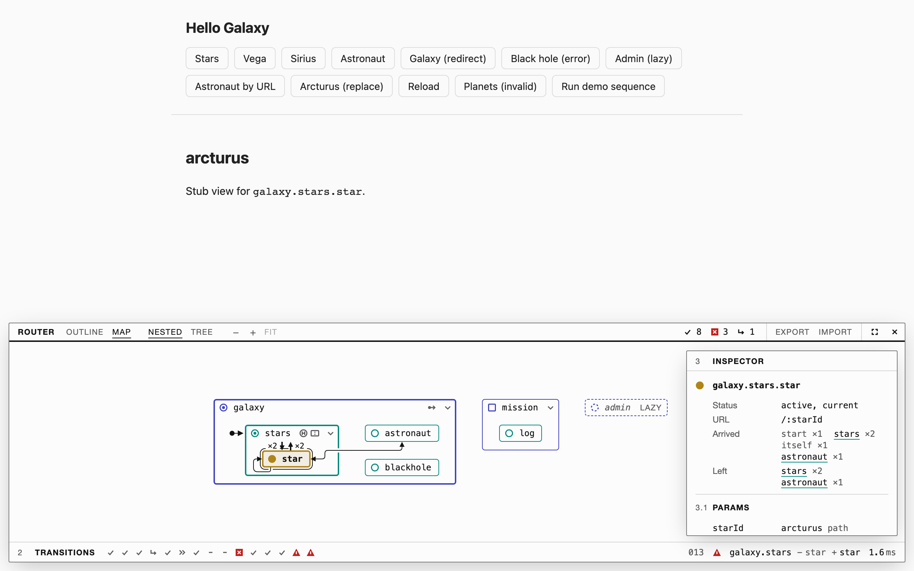
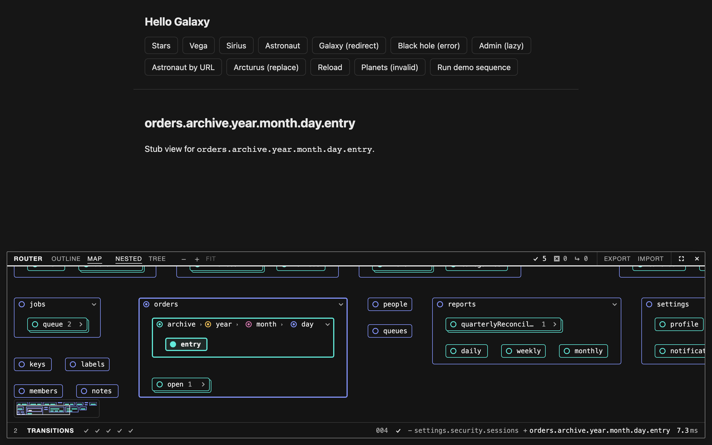

# The nested Map

The Map tab has two layouts. The node-link tree is the fallback. The nested
layout draws the state tree as statechart containment: a box per state, child
states inside their parent. This page records the prior art behind the nested
layout and the rules it follows. The [proposal](README.md) holds the design
direction, and [devtools scope](devtools.md) the package's wider plans.

## Rules

- **No edges at rest.** UI-Router declares no transitions, so every edge is an
  observed one. Selecting a transition draws its edge and, for a redirect, a
  dashed edge from its origin. Selecting a state draws its traffic in and out,
  one line per pair of states, with a chip for a count above one and line
  weight as a second cue.
- **The diagram owns the panel.** On the Map tab in the wide dock the
  transition log is a strip of outcome glyphs, and the inspector is a popover
  beside the diagram. The maximised panel gives the diagram three fifths of
  its height and shows the full log and inspector below it. On the sheets the
  Map takes the Outline's place above the log.
- **Boxes keep their natural size.** A leaf is its label and padding. A
  compound shrink-wraps its children. Nothing stretches to fill the viewport;
  the diagram sits in the room [left for it](#the-inspector-popover).
- **The layout is one thing and the view of it another.** The packer places
  the boxes; the [viewport](#the-viewport) decides where that drawing sits in
  the panel. Resizing the panel moves the view and leaves the layout alone
  until the room has a different shape.
- **A selection moves nothing.** Selecting a state draws its edges and shows
  the inspector, and every box stays where it was, so nothing shifts under
  the pointer.
- **Colour is identity, until a transition is in focus.** See
  [Modes](#modes).
- **Selection is a layer of its own.** A selected box gets a ring outside
  its border, in `--uird-select`. The border goes on saying what it said:
  identity at rest, status while a transition is in focus.
- **Red means fault.** A failed transition's edge and the state that failed
  are red, and no identity colour is near it.
- **Type is 12px in the dock.** The fitted layout may shrink to the caption
  size and no further, and the maximised panel is the one place it enlarges
  by itself. Any change of size, the viewer's zoom included, is a whole step
  of the [spacing system](#spacing), never a scale factor.

## Modes

The Map does not make one picture carry every encoding. Colour and arrows have
a different job in each mode, and `data-mode` on the panel names the mode.

| Mode                         | Colour                                                                                                                 | Arrows                                             |
| ---------------------------- | ---------------------------------------------------------------------------------------------------------------------- | -------------------------------------------------- |
| At rest (`rest`)             | identity, on every border and glyph                                                                                    | none                                               |
| A state selected (`state`)   | identity, so the named boxes can be found                                                                              | the state's traffic, with counts                   |
| A transition in focus (`tx`) | status: `--uird-active` on what it enters or retains, `--uird-exit` on what it exits, red on a fault; identity recedes | that transition's edge, and its redirect's, dashed |

A transition is in focus while it is selected, previewed from the strip or
running.

Weight, dash, wash and glyph say the rest, and they do not change with the
mode, so greyscale and forced colours read the same:

| Role               | Border              | Glyph            | Also             |
| ------------------ | ------------------- | ---------------- | ---------------- |
| Current            | 2px solid           | solid disc       | wash, weight 700 |
| Active ancestor    | 2px solid           | ring with a dot  |                  |
| Inactive           | 1px solid           | ring             |                  |
| Lazy               | 1px dashed          | dashed ring      | italic, `LAZY`   |
| Entering           | 2px solid           | plus in a ring   | wash on a leaf   |
| Retained           | 1px solid           | bars, or diamond |                  |
| Exiting            | 2px dashed          | minus in a ring  | muted name       |
| Errored            | 2px solid, red      | red square       | red name         |
| Collapsed compound | stacked second edge |                  | count of states  |

Selection and keyboard focus are rings, and neither touches the border:

| Layer    | Ring                                  | Colour                                    |
| -------- | ------------------------------------- | ----------------------------------------- |
| Selected | 1px, 2px outside the box              | `--uird-select`, the ink unless it is set |
| Focused  | 2px, inside the border, on the header | the ink                                   |
| Both     | both rings, the border between them   |                                           |

`--uird-select` is one token, no depth's colour and no status's. As the ink it
is 18:1 on the surface in the light scheme and 16:1 in the dark. In forced
colours the selection ring is `Highlight` at 2px. A hue of its own for
selection was weighed: the widest gap the four depths, the two statuses and
the red leave is at green, which beside that red reads as a status. The ink
is neutral, and a ring is told from a border by where it is.

## Layout

No surveyed tool fits its layout to the shape of its container. The XState
visualiser measures HTML nodes and hands them to `elkjs`; Mermaid scales the
whole drawing; KIELER collapses what is out of focus; itemis CREATE moves a
composite's contents to another diagram. A wrapping flex row fills one row
greedily, which leaves a wide dock half empty. Stretching boxes to fill the
dock gives bars for leaves and compounds that are mostly blank.

The packer places every box, and CSS only draws them:

1. Measure each leaf and header. The text widths come from a canvas, so
   packing needs no render.
2. Size each leaf to its label, between 56px and 208px, on the 4px grid.
3. Bottom-up, split each compound's children into contiguous rows in
   declaration order, trying every row count. Within a row, a run of short
   boxes beside a tall one stacks into as many rows as the tall one's height
   holds. Each split is scored on how far its width over height is from a
   target, the Map viewport's for the root and about 2 for inner compounds,
   plus one and a half times the share of its rows left empty. The root
   prefers a split that fits the viewport to a nearer one that does not.
4. A compound is its header, its rows and its padding, and no wider than the
   wider of the two needs.
5. If the root still does not fit, step down the ladder below. In the
   maximised panel, first step up it.
6. The [viewport](#the-viewport) places the diagram: in the middle of the
   room at that size, or as near the middle as leaves
   [the popover's column](#the-inspector-popover) free. The room left over
   frames it; no box takes it.

The rule comes from ELK's `rectpacking`, which keeps input order, stacks short
boxes and aims for an aspect ratio. Area-weighted treemaps do not fit: they
have no minimum box size and no notion of a label's width.

The packer is `src/element/pack.ts` in the package: boxes in, placed boxes
out, with no DOM. `src/element/viewport.ts` is the view of it: a size and a
room in, an offset out. The packer's specs hold the layout to four checks, for the sample
tree and the stress tree, in the dock (1230 by 256) and the maximised panel
(1230 by 372): no leaf is wider than its label needs or than the maximum; no
compound is wider than its header and rows need; in every compound the boxes
cover at least half of the rows' bounding box; and the diagram fits, with a
width over height between 0.6 and 1.6 times the viewport's. The two larger
steps are held to the second and third, for the sample tree.

### Spacing

Every distance is a multiple of the panel's 4px unit, and the gaps and padding
are multiples of its 12px module. `METRICS` in `pack.ts` holds the values.

| Distance                                     | Size        |
| -------------------------------------------- | ----------- |
| Leaf block size, and a compound's header row | 24px        |
| Leaf inline size                             | 56 to 208px |
| Padding inside a leaf, inline                | 8px         |
| Compound padding, inline and block           | 24px, 12px  |
| Between leaves in a row, and between rows    | 24px, 24px  |
| Between a compound and its neighbours        | 36px, 36px  |
| Outer margin, from the panel's padding       | 12px        |
| Box corner radius                            | 4px         |

A leaf and the gap beside it are the same 24px, so a block of leaves reads as
an even grid. A compound stands half as far again from its neighbours, so
groups read as groups. The block padding is 12px because the dock is 256px
tall and three levels of nesting must fit in it.

The edge router's margins come from the same numbers: a route keeps 6px from
any border, the middle of the narrowest gutter, and an end's lead is 12px, the
middle of a 24px one.

At the caption-size rung the header is 20px, the padding 16px and 8px, the
leaf gaps 16px and 12px, and the group gaps 24px and 16px.

The maximised panel has two larger steps, each the table above in proportion
to its type, still on the 4px grid:

| Step  | Type | Header | Compound padding | Leaf gaps | Group gaps | Leaf inline size |
| ----- | ---- | ------ | ---------------- | --------- | ---------- | ---------------- |
| Dock  | 12px | 24px   | 24px, 12px       | 24px      | 36px       | 56 to 208px      |
| Roomy | 16px | 32px   | 32px, 16px       | 32px      | 48px       | 76 to 276px      |
| Large | 20px | 40px   | 40px, 20px       | 40px      | 60px       | 92 to 348px      |

A header's glyphs, marks, padding and fold button grow by the same factor,
from one custom property on the diagram. Edge strokes, arrowheads and the
router's margins stay as they are in the dock.

A scale on the whole diagram was weighed against the steps. A scale fills any
viewport exactly, and gives type and borders at sizes that are on no grid; the
steps keep every distance a multiple of 4px and the type at three sizes. A
different target shape for the packer was also weighed: the root already aims
for the viewport's shape, and the sample trees are wider than the maximised
viewport is, so a taller target would give more rows of boxes that are still
the dock's size.

### When it does not fit

In the maximised panel the layout first tries the large step and then the
roomy one, with every compound open, and takes the first that fits with a
tenth of the viewport's width and height to spare. The dock never enlarges.

Otherwise the layout starts at the dock's step with every compound open and
stops at the first step that fits. Each step keeps the ones before it:

1. Collapse compounds off the active path to one box with a count of the
   states inside. A selected transition's states and the ancestors of a
   selected state stay open; the selected box itself stays as it is drawn.
   Opening or closing a box by hand overrides this for that box.
2. Merge a compound with its only visible child, when that child is also a
   compound, into one header.
3. Truncate a name segment longer than 24 characters in the middle. The full
   name stays in the accessible name and the `title`.
4. Shrink to the caption size.
5. Stop shrinking. The layout is drawn at the dock's size with whole names,
   every compound off the active path collapsed, and the
   [viewport](#the-viewport) pans it.

A milder step is restored only once it fits with about 10% of the inline size
to spare, so a resize does not flicker between layouts. A change to the tree,
or a selection that opens a compound, starts again from the top; a selection
that opens nothing keeps the layout it has. Below 560px of inline size the
nested layout is not offered: at that width it is the Outline with borders.
The node-link tree is the viewer's choice at any width and is not a rung:
falling back to it would swap one drawing for another when a compound is
opened by hand.

Re-rooting at the deepest compound on the active path, with its ancestors as a
breadcrumb, would sit before the fallback. It is left out: it needs a second
navigation model for the states outside the new root, and the stress tree (60
states, six levels, 20 top-level siblings) fits a 1256px dock without it.

A compound's header ends in a button that closes it, and a collapsed
compound's in one that opens it. A merged header has one, at its end, for the
box the header belongs to.

### The viewport

The ladder chooses what is drawn. The viewport is how a drawing larger than
its room is still reached, and how a resize is kept from moving boxes.

- **One translation.** The view is the diagram's offset from its room, in
  whole pixels, applied as one `translate` on the diagram's root. Nothing is
  scaled, so type and 1px borders stay on the pixel grid.
- **Fit.** Fitted, the diagram is centred as [Layout](#layout) says. A
  diagram that overflows is fitted with the current state in the middle of
  the room, as far as the diagram's edges allow. `Fit` in the panel header
  returns to this view.
- **Zoom is the type step.** `−` and `+` move through the four steps of the
  [spacing system](#spacing): 11px, 12px, 16px and 20px. Each is a layout of
  its own, packed for a room scaled with its type so that it keeps the
  fitted arrangement. What is drawn does not change with the step: the
  ladder's rung is chosen for the fitted size and kept. In a panned view, a
  zoom holds the point in the middle of the room still; from the fitted view
  it re-applies the fitted placement instead.
- **When a resize packs again.** The layout is kept while the ladder's rung
  is the same, the diagram still fits (or is being panned or zoomed), and the
  room's width over height is within a quarter of the one it was packed for.
  The view is then re-fitted and no box moves inside the diagram. The dock
  and the maximised panel are two shapes, so that change packs again, and
  returns to the fitted view.
- **Pan.** A drag anywhere on the Map, past 4px so that a click still
  selects; the wheel, which scrolls the page once the diagram's edge is
  reached, as any scroller does; Shift with an arrow key, 48px a press. An
  axis the diagram fits on does not pan. An overflowing diagram can be pulled
  320px past the room's inline end in a dock without the popover's column,
  and 84px past its block end, so nothing stays under the popover or the
  minimap.
- **Wheel zoom takes a modifier.** With Control or Command held, which is
  also what a pinch sends, the wheel changes the type step. Without one it
  never zooms, so the page under the panel scrolls as usual.
- **Focus brings its box into view.** Focus that moves by keyboard, or from a
  link in the inspector, pans the least that shows the whole box with a 12px
  margin. A click never pans: nothing moves under the pointer.
- **A re-pack keeps the focused box where it is.** Opening or closing a
  compound in a panned view holds the focused box's corner still and moves
  the rest.
- **Minimap.** While the layout overflows, a thumbnail of it, at most 144px
  by 60px, sits at the block end and inline start of the room, the corner
  the popover's column never takes. Leaves are filled and open compounds
  outlined in their depth colours, the current state is ink, and the part in
  view is outlined. A press or a drag on it puts that point in the middle of
  the room. It is absent whenever everything fits.

| Fitted, a state selected                                            | Overflowing, panned, with the minimap                         |
| ------------------------------------------------------------------- | ------------------------------------------------------------- |
|  |  |

A continuous scale with a fit-to-view, which is what node-graph editors have,
was weighed for the viewport as well. It keeps one layout at every size and
puts type at sizes such as 13.7px and borders between pixels. Stepping the
metrics first and using the transform only to pan, and to animate the change
between two steps, keeps both.

The idea of handles as declared ports, the viewport with a fit action, edge
labels and the minimap are taken from node-graph editors, xyflow among them.
Their drag, connect and resize affordances are not: the Map is read-only.

### The inspector popover

The popover is 296px wide, and its column, with a 12px margin either side, is
320px. Whether the dock has that column to spare is decided by the diagram's
size, before anything is selected:

- **Room for a column either side:** the diagram is centred, and the popover
  takes the column at the end.
- **Room for one column:** the diagram sits as near the middle as leaves the
  column free at the end, so the room at its start shrinks first. The popover
  takes that column. The viewport's fit reserves it.
- **No room:** the diagram is centred and the popover goes over it. It tries
  beside the selected box, level with its top or its bottom, then the corners
  of the panel, then every 12px along the panel's top and bottom, and takes
  the place that covers least. The selected box counts a thousand times a
  pill, and a drawn edge or a box an edge ends at twenty times, so the
  selection is covered only when no place clears it.

In the first two the popover is always in the same place, at the end of the
dock, and neither a first selection nor a change of selection moves a box.
Reserving the column at every width was weighed and left out: the stress tree
needs the dock's whole width. So was a start-aligned diagram, which leaves
the same column free and reads as a document, not a drawing.

## Motion

A box changes place and size between modes, and the eye follows a state
through the change by its colour and its movement.

- **Boxes move and change size.** A re-pack, a collapse or an expand, a
  change of rung and the switch between nested boxes and the tree all move
  the same states. Each state's element starts where and as large
  as the state was and eases to its new place and size in 200ms, on
  `--uird-ease-out`. A box that was not drawn before fades in, and is
  clipped by its parent until the parent has grown to hold it. A header
  keeps its final width through the change, so no name is elided on the way.
- **The diagram changes size as one object.** When the type step changes,
  between the dock and the maximised panel or by a zoom, the whole diagram
  scales from its old outline to its new one and its boxes ride it. The panel
  itself changes size at once, so the old outline is taken from where the
  diagram sat in its room, not on the page: a centred diagram grows about
  its middle and does not travel. A step that also rearranges the boxes,
  so that the outline changes its proportions by more than a tenth, moves
  them one by one instead.
- **The view eases.** `Fit`, a pan by keyboard and a box brought into view
  move the diagram in the same 200ms. A drag, the wheel and the minimap move
  it at once. A resize that only re-fits moves a centred diagram with its
  room and animates nothing.
- **Edges draw.** An edge draws in from its start in 240ms and withdraws
  toward its end in 160ms. After a re-pack the edges wait the 200ms the boxes
  take, and then draw, so none is stranded beside a moving box. A count chip
  fades in once its line has drawn.
- **A running transition marches.** Its edge is dashed and the dashes travel
  toward its head until the transition settles.
- **The popover fades in** over 160ms where it is placed.
- **Reduced motion.** Positions change at once. Edges, new boxes and the
  popover fade, a running transition's edge is solid, and nothing else
  animates.

The mechanism is FLIP on the Web Animations API. Before a render that changes
the Map's geometry the panel reads where each state's element is drawn, and
after it reads where each now is and animates a `transform` from the
difference. A child's shift is taken relative to its parent's, since it rides
its parent's transform, and the room's own shift on the page is taken out, so
a panel that changes size carries its diagram with it. Every element is read
before any is animated. A box
whose size changed also animates `width` and `height`; the boxes are
absolutely placed, so that layout is theirs alone. Opening and closing a
compound in the stress tree's dock, with 20 to 26 boxes drawn, the frame that
re-packs took 21 to 27ms and every frame after it 16.7ms, in headless
Chromium. A change of type step animates one `transform` with a scale on the
diagram's root instead. Nothing waits on an animation. An interrupted move starts from what is on screen: the
first read is of the drawn position, mid-flight included, and the earlier
animation is cancelled before the second.

Edges are revealed by an SVG mask whose stroke offset animates, so a dashed
edge draws in the same way as a solid one.

The View Transitions API was tried and left out. In Chromium 158 a
`view-transition-name` on a box inside the panel's shadow root, in its
`popover`, got no transition group: only the document root and a light-DOM
probe did. While the transition ran, hit testing anywhere on the page
returned the transition overlay, so the whole document took no input. A
document-level transition is also the host page's to start, and one started
by the panel would cut across the page's own. `Element.startViewTransition`
exists in that build and was not pursued, for the same top-layer and
shadow-root reasons. Firefox and WebKit were not probed.

Path morphing of an edge between two routes is left out; a re-routed edge is
redrawn.

## Edge routing

No package is both small and able to route around several nested obstacles.

| Package                          | Avoids obstacles    | Size (gzip)       | Licence           |
| -------------------------------- | ------------------- | ----------------- | ----------------- |
| `elkjs` 0.12.1                   | lays out and routes | 477 kB            | EPL-2.0           |
| `libavoid-js` 0.5.0-beta.5       | yes                 | 181 kB wasm + 17  | LGPL-2.1          |
| `obstacle-router` 0.1.2          | yes                 | 48 kB             | LGPL-2.1          |
| `@dagrejs/dagre` 3.1.3           | no                  | 17 kB             | MIT               |
| JointJS `manhattan` router       | yes, uniform grid   | part of JointJS   | MPL-2.0           |
| xyflow step and smoothstep edges | no                  | part of xyflow    | MIT               |
| Excalidraw and tldraw elbows     | the two end boxes   | part of each tool | MIT, tldraw's own |

The router is hand-written, after Wybrow, Marriott and Stuckey's "Orthogonal
Connector Routing" (Graph Drawing 2009), the algorithm behind `libavoid`:

- **Obstacles.** Every box that is not an ancestor of either end blocks the
  route. Ancestors are transparent, as in JointJS, but every header row blocks,
  so a route never crosses a label.
- **Grid.** Lines sit at each box's edges offset by a margin, at its centre and
  at gutter midlines, never on a border. A route can cross a border and cannot
  run along one.
- **Leads.** An edge leaves and enters a box at a right angle, with a straight
  lead before its first bend: to the middle of the gutter it faces, and 12px
  into open space. A bend nearer the box than that costs extra, so a side with
  room for a lead is preferred to a nearer one without.
- **Search.** A\* over (node, direction) states, with a penalty per bend and no
  reversal. Ties break on fewer bends, then on a fixed expansion order, so the
  same geometry gives the same route.
- **Ports.** Every end gets a side and a place on it before any edge is
  routed, as a handle would on a node-graph editor's node.
  - _Side._ The side that faces the other end. For a diagonal, the axis whose
    straight lead is clear of other boxes; when both are, one end takes the
    longer axis and the other the shorter, so the route has one bend. A box
    inside a compound the edge has to leave does not use its top, where the
    compound's header is in the way.
  - _Budget._ A side holds as many ports as fit 12px apart and 6px from its
    corners: two on a leaf's 24px end, eight on a 104px top. An end that
    finds its side full takes the next side it prefers. Once every side is
    full, ends share ports with their neighbours, as one trunk into the box.
  - _Order._ Ports on a side sit around its middle in the order of where
    their edges go, so two edges do not cross on the way out.
  - _Search._ One pass routes from the planned ports. An edge the plan
    leaves without a route is searched again from the middle of every side.
- **Trunks.** Opposite traffic between one pair of states is one line with a
  head at each end, so a box has one port per neighbour. No edge ends under
  another's arrowhead.
- **Channels.** A free segment moves to the middle of the gutter it runs in.
  In a gutter wider than 48px it keeps 12px from the nearer border instead.
- **Nudging.** Segments that share a line spread across the channel in a
  fixed order, greedily and without a solver. Opposite edges between one pair
  each keep to their right.
- **Templates.** Three shapes are planned, not searched for.
  - _A compound and a box inside it._ The edge ends on the compound's
    header, the part of it that reads as the state: on the header's bottom
    edge, straight above a child with nothing between, as a stub the height
    of the padding. For a box deeper inside, or one with a sibling above it,
    the edge runs down a lane beside the branch that holds the box and the
    box is entered from that side. The two directions are two stubs a port's
    step apart, since one stub is too short for two heads.
  - _A self-loop._ Out of the top or bottom near a corner and back into the
    side beside it. The loop takes the corner whose two sides hold the
    fewest planned ports, and of those the one with most room: the top at
    the end first. It is chosen after every other edge of the box has its
    side, so it never lands on a corner already in use.
  - _A hidden end._ An edge whose end sits inside a collapsed compound stops
    at that box's border with a stub cap, and one whose ends are both inside
    the same box becomes that box's loop.
- **No route.** A straight dotted line joins the two boxes, and the result is
  flagged as a fallback.
- **Counts.** A line travelled more than once carries a chip: `×3`, or for a
  line both ways the two counts, each beside an arrow for the way its traffic
  travels. The chip is 12px tall, in 11px monospace with tabular figures, on
  the surface colour. It sits on its line as near the middle as is clear of
  every box, every other line and every other chip, and beside a line too
  short to carry it. With no clear place it is left out, and the line's
  weight still says more than one. `src/element/chips.ts` places them.
- **Arrowheads.** One head for every weight, 7px long and 7px across, on
  strokes of 1px to 3px. A redirect's dashed edge ends in an open chevron of
  the same size, so the two read apart without colour. Edges are ink with a
  halo of the surface colour, which keeps them clear of the identity colours
  they cross.
- **Output.** Corners are rounded at 4px, 6px on a loop, and coordinates sit
  on the device-pixel grid, mid-pixel for an odd stroke.

The router is `src/element/route.ts`: rects in, paths out. Edges are routed in
id order, so the same boxes and edges give the same paths.

The edges drawn come from `observedEdges` in `src/edges.ts`, which folds a
recorded session into one edge per ordered pair of states with its count and
outcomes. A selected state shows its successful traffic, 1px for one
transition, 2px for two or three and 3px for four or more; a line both ways
takes the heavier direction's weight.

The constraint solver `libavoid` uses for nudging, crossing minimisation and
labels on lines are left out.

What still reads poorly:

- A stub between a header and its child is 12px in the dock, most of which is
  its 7px head, so a heavy stub is nearly all arrowhead.
- A line both ways across a 24px gutter is two heads and little line.
- The sides are chosen from where the boxes sit, before any search. An edge
  that has to go round a third box can leave by a side the search would not
  have picked, and takes a bend more than it needs.
- A self-loop's far side runs 3px from the selection ring of its own box.
- Ports that share a place overlap for their first segment; nothing marks
  the point where a trunk parts.

### WebAssembly

The router is TypeScript only. A spike built the same search in dependency-free
Rust compiled to WebAssembly and compared the two on identical routes:

|                                      | TypeScript | WebAssembly                  |
| ------------------------------------ | ---------- | ---------------------------- |
| Size, gzip                           | 2.2 kB     | 3.9 kB as a file, 4.9 inline |
| One edge, 14 boxes (Chromium)        | 0.13 ms    | 0.10 ms                      |
| Six edges, 60 boxes (Chromium)       | 3.8 ms     | 2.4 ms                       |
| Cold first call, six edges, 60 boxes | 9.7 ms     | 6.2 ms                       |

Both are well inside a frame. Under `script-src 'self'` every way of loading a
module fails in Chromium and WebKit; WebAssembly needs `'wasm-unsafe-eval'`.
The panel runs inside host apps, so a TypeScript router would have to ship as
the fallback either way. A mode that routes every observed edge at once, a few
hundred per resize, is where a WebAssembly router in a worker would start to
pay.

## Loading

The nested layout, the packer, the edge router, the chips, the viewport and the node-link tree, with
`d3-hierarchy`, are one module, `src/element/map.ts`, that the panel imports
on first use of the Map tab. A panel that only ever shows the Outline does not
load it. The package's build emits a module per source file, so the import is
a relative `import('./element/map.js')` in `dist`, which a bundler turns into
a chunk of its own.

## Accessibility

Containment maps onto a tree. The viewport changes nothing about it: the tree,
its items and their order are the same whatever is in view. Each box's header is a `treeitem` that owns,
through `aria-owns`, the `group` of child items in the same box, with
`aria-expanded` on compounds only. The header is the item, not the box, so
that an item's name is its header alone: a name computed from a box's content
would take in every state inside it. Arrow keys move in tree order, as in the
Outline, not spatially. A re-pack moves a box's element and does not replace
it, so focus stays on the same state. A focused state that is out of view is
panned into it.

Shift with an arrow key pans, `+` and `-` change the type step and `0` fits,
while focus is in the tree. `Zoom out`, `Zoom in` and `Fit` are buttons in
the panel header. The minimap is a pointer's shortcut to what those keys do
and is hidden from assistive technology.

The button that closes or opens a compound is named for what it does,
`Collapse contacts` or `Expand contacts`. It is for the pointer and is not a
tab stop: the left and right arrow keys do the same on the item.

A truncated name carries its full name as the label, so there the label and
the visible text differ.

The scrubber is a `listbox` of transitions. Left and right arrows move the
selection, and the selected transition's notation sits beside it.

The edge overlay, count chips included, is hidden from assistive technology. The WAI-ARIA Graphics
Module defines no connector role, and `aria-flowto` support is partial. The
inspector states the same relations in words, as lists of states that select
and focus the box they name.

## References

- Harel, "Statecharts: A visual formalism for complex systems", 1987:
  <https://doi.org/10.1016/0167-6423(87)90035-9>
- Wybrow, Marriott and Stuckey, "Orthogonal Connector Routing", 2009:
  <https://users.monash.edu.au/~mwybrow/papers/wybrow-gd-2009.pdf>
- ELK `rectpacking`:
  <https://eclipse.dev/elk/reference/algorithms/org-eclipse-elk-rectpacking.html>
- ELK top-down layout:
  <https://eclipse.dev/elk/blog/posts/2023/23-04-11-topdown-layout.html>
- The XState visualiser's layout, `src/graphUtils.ts`:
  <https://github.com/statelyai/xstate-viz>
- xyflow, for handles, the viewport, edge labels and the minimap:
  <https://github.com/xyflow/xyflow>
- JointJS `manhattan` router:
  <https://github.com/clientIO/joint/blob/master/packages/joint-core/src/routers/manhattan.mjs>
- itemis CREATE subdiagrams:
  <https://www.itemis.com/en/yakindu/state-machine/documentation/edit_using_subdiagrams>
- Schulze, Lasch and von Hanxleden, "Label management", 2016:
  <https://doi.org/10.1109/VLHCC.2016.7739657>
- WAI-ARIA tree view pattern:
  <https://www.w3.org/WAI/ARIA/apg/patterns/treeview/>
- WAI-ARIA Graphics Module: <https://www.w3.org/TR/graphics-aria-1.0/>
- Machado, Oliveira and Fernandes, "A physiologically-based model for
  simulation of color vision deficiency", 2009:
  <https://doi.org/10.1109/TVCG.2009.113>
- FLIP: <https://aerotwist.com/blog/flip-your-animations/>
- The CSS guideline the panel follows: <https://good-css.com>
