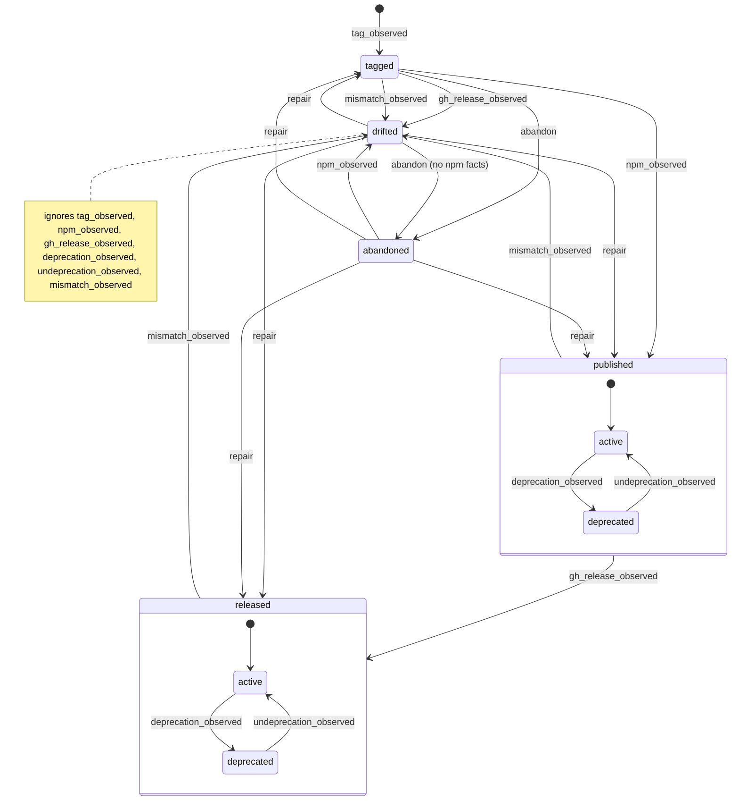

# @www/release-ledger

The release ledger's D1 schema and the pure state machine that folds release
observations into it. The design is
[#1430](https://github.com/simshanith/lit-ui-router/issues/1430).

- [`migrations/`](./migrations): the D1 schema. Its `CHECK`s hold each
  `versions` row's state to the facts it records.
- [`src/release-ledger.core.ts`](./src/release-ledger.core.ts): the transition
  table, `fold`, and the compare-and-set statements the queue consumer runs in
  one D1 batch.

## Transitions

Generated from `TRANSITIONS`; `src/release-ledger.diagram.test.ts` fails when
this copy differs. Same-state pairs are not drawn: a repeated fact is a no-op, a
changed mutable fact updates in place, and a contradicted immutable fact is
rejected.

